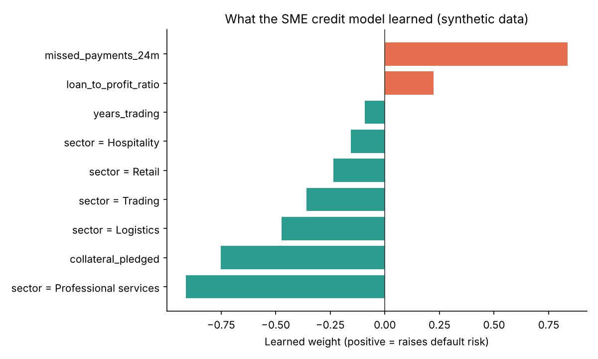
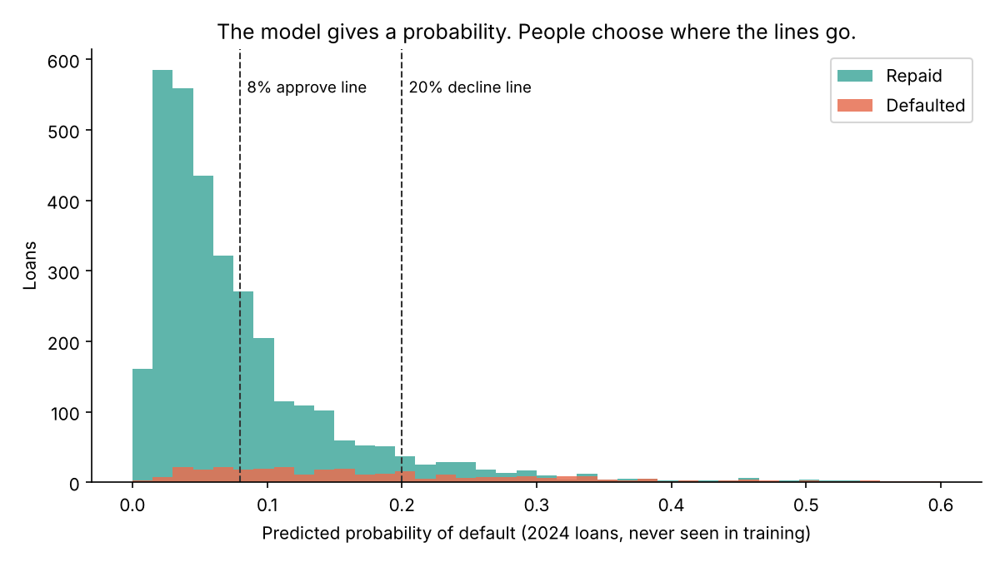

# Module 02: AI Foundations

**Problem:** Meridian Gulf Bank's leadership says "the model declined her". Nobody can explain how the SME credit model (AI-001) learned, what it actually decides, or which parts of it people chose.

**What I built:**
- A logistic-regression credit model trained on 17,463 synthetic SME loans, tested on a held-out year it never saw
- A two-page **executive explainer** on how the model learns, written for the board
- A **model review** applying ten governance questions to the model's evidence
- A **learned-vs-chosen register** giving every human design decision an owner and a rationale

**Standards applied:** ISO/IEC 42001 (Annex A data and lifecycle controls), NIST AI RMF (Map and Measure), EU AI Act Annex III point 5(b) (creditworthiness as a high-risk use).

## Results

| Check | Result |
| --- | --- |
| Data leakage | `referred_to_collections` inflated test AUC to **0.99**; removed (true AUC **0.79**) |
| Overfitting | Deep tree: train AUC 1.00, test 0.54. Rejected in favour of the scorecard |
| Accuracy trap | "Nobody defaults" scores **91% accuracy** and catches **0%** of defaults |
| Thresholds | Same model: 995 applicants get human review under one policy, 0 under another |
| Unequal outcomes | Owner group not an input, yet approval impact ratio B/A = **0.91** via collateral |
| Missing outcomes | Only 86 hospitality loans pre-2022 because most were declined |

**Read:** [Executive explainer](executive-explainer.md) · [Model review](model-review.md) · [Learned vs chosen register](learned-vs-chosen-register.md)

## How it works

1. `scripts/generate_sme_loans.py` builds the synthetic loan book with four planted governance problems (leakage, proxy route, missing outcomes, label definition).
2. `scripts/train_credit_model.py` trains the model on 2019–2023, tests on 2024, runs seven checks and writes everything to `outputs/`.

To run locally: `pip install -r ../../requirements.txt`, then run both scripts.

## What I would do at work

- **Ask for train and test scores side by side.** A large gap or a near-perfect score is a red flag anyone can spot.
- **Never accept "accuracy" for rare events.** Ask for recall, precision and the cost of each error type.
- **Put every threshold and feature choice in a register with an owner.** That is where accountability actually sits.

## Files

| Path | Purpose |
| --- | --- |
| `executive-explainer.md` | Board-level explanation of how the model learns |
| `model-review.md` | Ten-question governance review with ratings and actions |
| `learned-vs-chosen-register.md` | Owned register of every human design decision |
| `scripts/` | Data generator and model training/review script |
| `data/` | Synthetic SME loan book (2019–2024) |
| `outputs/` | Results JSON, scorecard weights, outcomes by group, charts |

_Meridian Gulf Bank is fictional. All data is synthetic. This is independent study._
