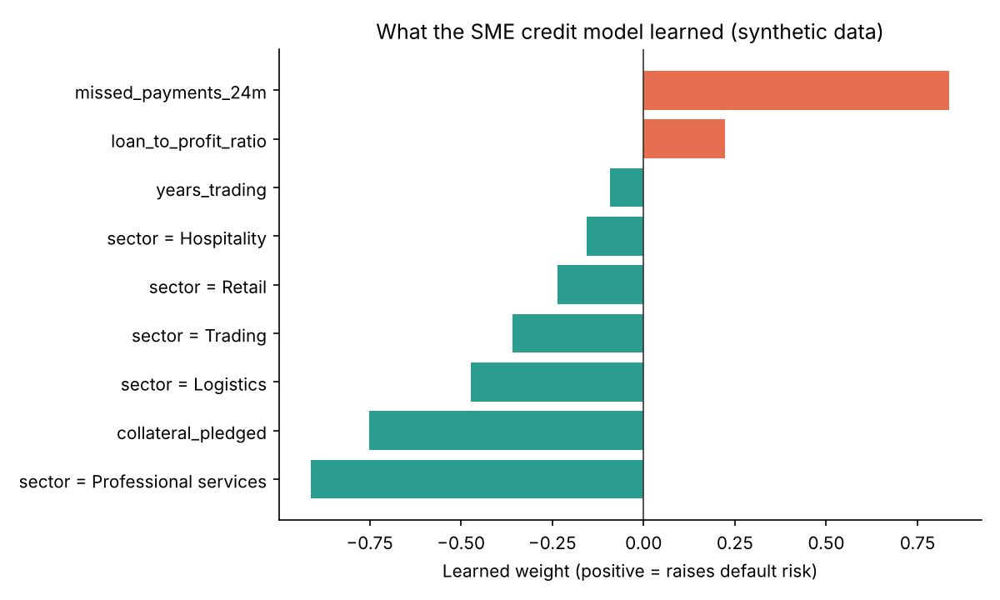
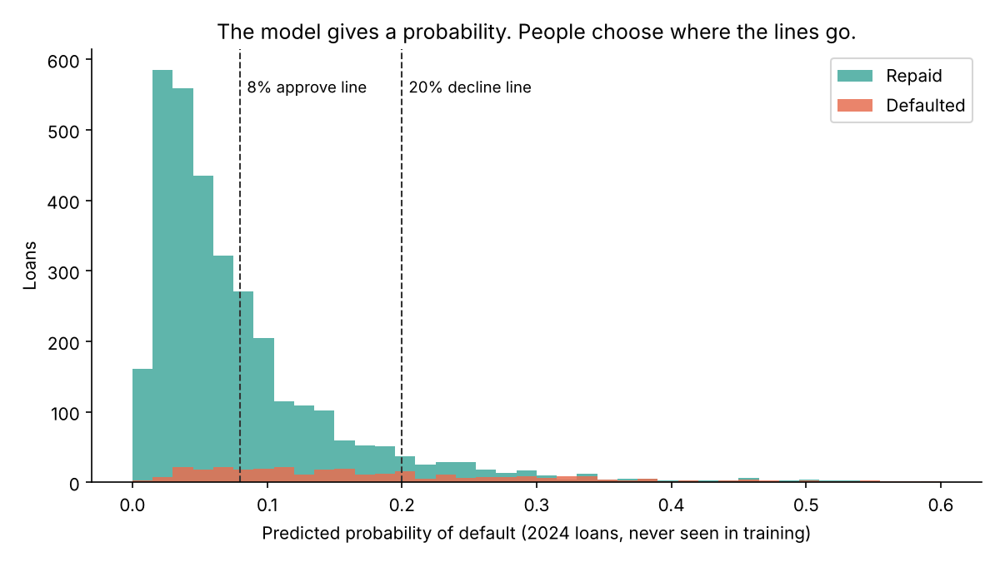

# How Our SME Credit Model Learns: An Executive Explainer

**System:** AI-001 SME credit scoring model · **Audience:** Executive Committee and Board Risk Committee · **Prepared by:** AI Governance · **Version:** 1.0 · **Date:** 2026-11-16 · **Classification:** Internal

> Meridian Gulf Bank is fictional and all figures come from synthetic data.

## 1. The short version

Our SME credit model does **not** decide who gets a loan. It estimates one number for each application: the probability that the business misses payments for 90 days or more within a year. **The bank decides** what to do with that number, through thresholds the Credit Committee sets. Accountability for every approval and decline therefore stays with the bank, never with "the model".

## 2. How it learned

We showed the model **13,880 past SME loans** from 2019–2023 where we already know the outcome: repaid, or defaulted. For each loan it saw a small set of facts (features), such as years trading, missed payments in the last two years, loan size relative to profit, collateral, and sector.

During **training**, the model adjusted a weight for each fact until its estimates best matched what actually happened. The result is very like a points scorecard:

| Fact about the business | What the model learned |
| --- | --- |
| Each missed payment in the last 2 years | Strongly raises risk |
| Collateral pledged | Strongly lowers risk |
| Loan large relative to profit | Raises risk |
| Each additional year trading | Lowers risk |
| Professional services sector (vs. construction) | Lowers risk |

Once trained, the model is used for **inference**: each new application gets a probability in under a second. Training happens once (and again at each retraining); inference happens about 400 times a day.

## 3. What was learned, and what we chose

| Learned from data | Chosen by people (needs an owner) |
| --- | --- |
| The weight on each fact | Which facts the model may use |
| Each applicant's probability | What counts as "default" (90 days late) |
| | Which years of loans to learn from |
| | The approve, refer and decline thresholds |
| | When an underwriter reviews the case |

The right-hand column is where most model risk sits, and where the board's attention belongs. The full register is in [`learned-vs-chosen-register.md`](learned-vs-chosen-register.md).

## 4. Why thresholds are a board-level decision

Applied to the 3,583 SME loans written in 2024, the same model gives very different outcomes depending on the policy we choose:

| Policy | Approved | Referred to underwriter | Declined |
| --- | --- | --- | --- |
| Current: approve below 8%, refer 8–20%, decline above 20% | 2,243 | 995 | 345 |
| Growth push: approve below 20% | 3,238 | 0 | 345 |

Moving from the current policy to the growth push removes all human review for almost 1,000 applications. That is a **risk-appetite decision**, not a technical one.

## 5. How good is it?

- On 2024 loans the model never saw, it separates defaulters from non-defaulters well (AUC 0.79, where 0.5 is a coin toss and 1.0 is perfect).
- It is **not** a crystal ball. Of the businesses that actually defaulted in 2024, it flagged 36% as above 20% risk. Underwriter review in the refer band remains essential.
- Be wary of "accuracy". A rule that predicts *nobody* will default would be 91% accurate and catch no defaults at all.

## 6. What the review found

The Week 2 model review ([`model-review.md`](model-review.md)) found three issues the committee should know about:

1. **A data leak was caught before use.** One field, "referred to collections", is only filled in *after* a default. With it, the model looked almost perfect (AUC 0.99). It has been removed.
2. **Unequal outcomes without a protected input.** Owner group is not a model input, yet group B businesses are approved less often (58% vs 64%) despite defaulting slightly *less* in 2024. The route appears to be collateral, which group B pledges less often. This needs a fairness review before the model goes further (Week 6).
3. **Thin evidence for hospitality.** Because we declined most hospitality applications before 2022, the model learned from only 86 hospitality loans from that period. Its view of that sector reflects our past choices, not the sector's true risk.

## 7. Decisions requested

1. Confirm the Credit Committee as owner of the thresholds, with an annual review.
2. Require a fairness review of the collateral effect before the model is extended to the Dublin branch.
3. Require that any retraining is treated as a change: re-tested, re-approved and recorded in the AI inventory.
