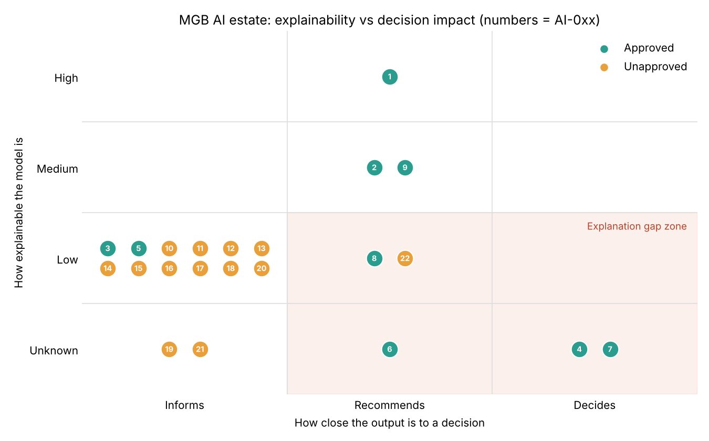
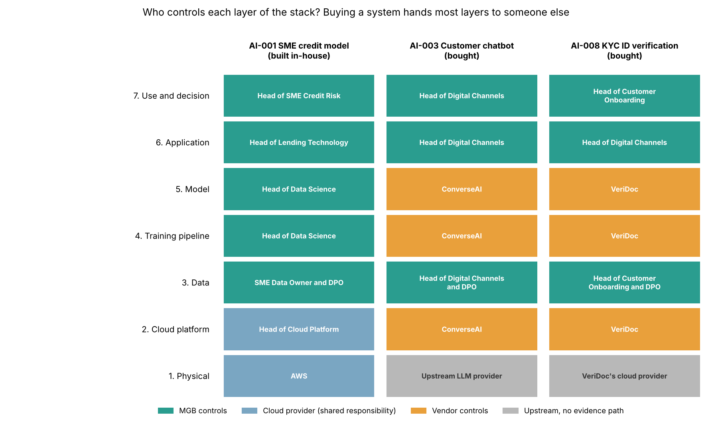

# Module 03: Models, Algorithms and the Stack

**Problem:** Meridian Gulf Bank knows *which* AI it runs (Week 1) but not *what kind* of model each system is, how explainable it is, or who controls each layer it runs on. Without that, nobody knows whom to ask for which evidence.

**What I built:**
- A classification of all **22 inventoried systems** by output type, algorithm family and explainability, merged into the living inventory
- An **explainability vs decision-impact** analysis that finds systems deciding about people while being unexplainable
- **System fact sheets** with seven-layer stack diagrams for three systems: one built, two bought
- A **stack control map** showing who controls each layer

**Standards applied:** Model Cards (Mitchell et al., 2019), ISO/IEC 42001 Annex A (AI system documentation), NIST AI RMF (Map function), EU AI Act Art. 13 (transparency to deployers) and Art. 25 (role change), cloud shared-responsibility model.

## Results

| Finding | Result |
| --- | --- |
| Systems classified | 22 |
| Explainability | 1 high, 2 medium, 14 low, 5 unknown |
| **Explanation gaps** (recommends or decides about people, low or unknown explainability) | **5**: fraud, next-best-offer, CV screening, KYC, adverse-media |
| Algorithm family not disclosed by vendor | 5 |
| Stack layers MGB controls | 5 of 7 for its own credit model; 3 of 7 for each bought system |

**Read:** [Explainability findings](explainability-findings.md) · Fact sheets: [AI-001 SME credit model](fact-sheets/AI-001-sme-credit-model.md) · [AI-003 Customer chatbot](fact-sheets/AI-003-customer-chatbot.md) · [AI-008 KYC ID verification](fact-sheets/AI-008-kyc-id-verification.md)

## How it works

1. `data/model_classification.csv` holds the classification and the basis for each judgement.
2. `scripts/classify_inventory.py` merges it into `00-inventory/inventory.csv` (adds `output_type`, `algorithm_family`, `explainability`, `fact_sheet`), flags explanation gaps and draws the chart. Safe to re-run.
3. `data/stack_map.csv` records owner, controller and key obligation for every layer of the three systems; `scripts/render_stack_map.py` draws the control map.
4. Each fact sheet includes a Mermaid stack diagram that GitHub renders directly.

## What I would do at work

- **Classify by output first.** It tells you what to test: error rates for classifiers, the top of the list for rankers, factual accuracy for generators.
- **Plot explainability against decision impact.** The bottom-right corner is where complaints, regulators and reputational damage come from.
- **Map the stack before asking for evidence.** It shows which questions go to your own teams, which to the vendor, and which have no answer at all.

## Files

| Path | Purpose |
| --- | --- |
| `explainability-findings.md` | Estate-wide findings and actions for the five gaps |
| `fact-sheets/` | Two-page fact sheets with stack diagrams for AI-001, AI-003, AI-008 |
| `data/` | Classification and stack map source data |
| `scripts/` | Inventory merge, gap analysis and chart scripts |
| `outputs/` | Explainability matrix (CSV), summary and charts |

_Meridian Gulf Bank is fictional. All data is synthetic. This is independent study._
