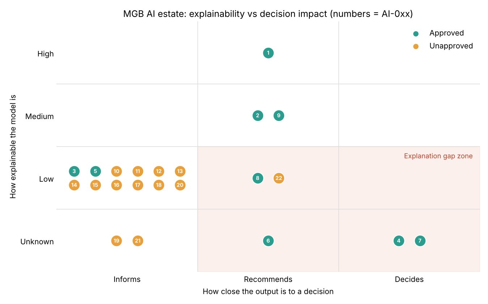
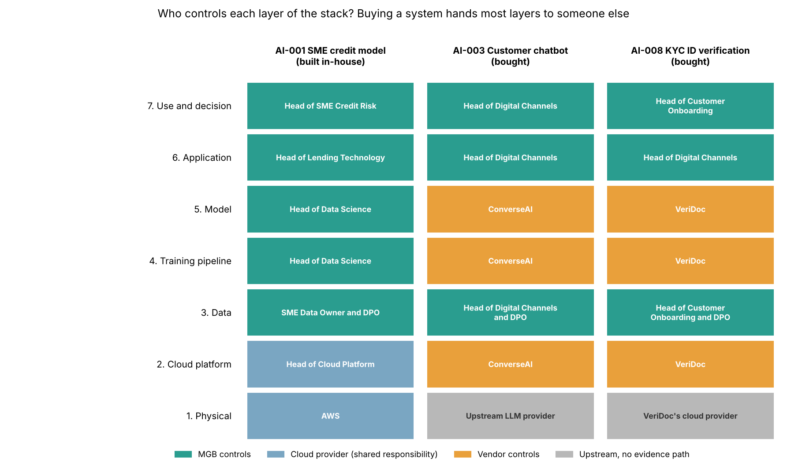

# Explainability Findings: MGB AI Estate

**Version:** 1.0 · **Date:** 2026-11-18 · **Prepared by:** AI Governance · **Source:** `00-inventory/inventory.csv` after Week 3 classification

## Summary

All 22 inventoried systems were classified by output type, algorithm family and explainability. **Five systems recommend or decide outcomes for people while MGB cannot explain how they work.** Four of the five are bought or embedded, and for three MGB does not even know which algorithm family the vendor uses.

## The estate at a glance

| Measure | Result |
| --- | --- |
| Output types | 12 generation, 5 classification, 2 ranking, 1 anomaly detection, 1 regression, 1 mixed |
| Explainability | 1 high, 2 medium, 14 low, 5 unknown |
| Algorithm family not disclosed by vendor | 5 systems |
| **Explanation gaps** | **5 systems** |

Most generative tools sit in the "informs" column: staff read the output and decide. They carry other risks (data leakage, false answers) but not an explanation gap.

## The five explanation gaps

| ID | System | Why it is a gap | Action | Owner |
| --- | --- | --- | --- | --- |
| AI-004 | Card fraud detection | **Decides** (blocks cards automatically); algorithm not disclosed | Ask vendor for model family and reason codes per block; confirm customers can get a card unblocked quickly | Head of Fraud Operations |
| AI-007 | CRM next-best-offer | **Decides** which offers customers see; method not documented | Ask vendor which inputs drive offers; exclude sensitive attributes in configuration | Head of Marketing |
| AI-006 | CV screening | Ranks candidates; method unknown; recruiters only read the top of the list | Ask for model documentation; record where recruiters stop reading; test top-30 composition by group (Week 17) | Head of Talent Acquisition |
| AI-008 | KYC ID verification | Deep networks recommend pass/refer for applicants | Request accuracy by age, skin tone and document type; keep human review for all failures | Head of Customer Onboarding |
| AI-022 | Adverse-media screening | Unvalidated deep model flags named clients | Already suspended from client decisions (Week 1); validate before reinstatement | Chief Compliance Officer |

## Who controls the stack

For the three systems with fact sheets, MGB directly controls **5 of 7 layers** for its own credit model but only **3 of 7** for each bought system. For the bought systems the bottom layer (physical) sits with an upstream provider MGB has no evidence path to.

## What this cannot establish

- Vendor-supplied classifications are taken from vendor statements and have not been verified.
- "Low" explainability describes the model type, not whether useful explanation tools exist for a specific system.
- Systems marked "unknown" may turn out to be simple and explainable once vendors respond.

_Meridian Gulf Bank is fictional. All data is synthetic._
