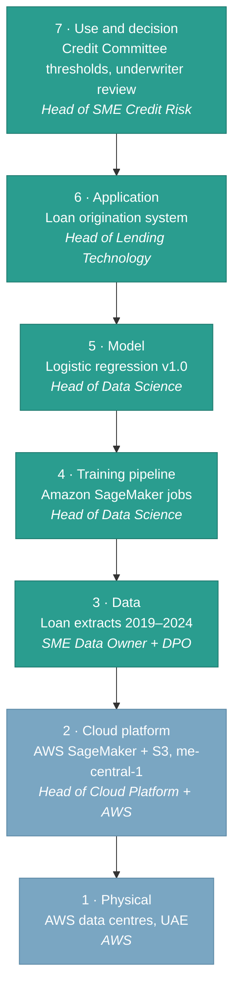

# System Fact Sheet: AI-001 SME Credit Scoring Model

**Version:** 1.0 · **Date:** 2026-11-18 · **Prepared by:** AI Governance · **Next review:** at next retraining, or 2027-11 at the latest

## 1. Identity

| Field | Value |
| --- | --- |
| Inventory ID | AI-001 |
| Model version | Logistic regression scorecard v1.0 |
| Business owner | Head of SME Credit Risk |
| Technical owner | Head of Data Science |
| Value-chain role | Builder + deployer (MGB is the provider) |
| Lifecycle status | Production |

## 2. Purpose

**Intended use:** estimate the probability that an SME loan applicant reaches 90+ days past due within 12 months, to support approve, refer and decline decisions under thresholds set by the Credit Committee.

**Out of scope (must not be used for):**
- Retail (consumer) lending
- Setting interest rates or credit limits
- Applicants of the Dublin branch, until a fairness review and local validation are complete
- Fully automated decline without a route to human review and challenge

## 3. Model

| Field | Value |
| --- | --- |
| Output type | Classification (probability of default) |
| Algorithm family | Linear (logistic regression) |
| Explainability | **High:** each feature's weight is readable, so reasons for a decision can be stated directly |
| Features | Years trading, missed payments (24 months), loan-to-profit ratio, collateral pledged, sector |
| Excluded on purpose | District (proxy risk), referred-to-collections (leakage), owner group |

## 4. Data

| Field | Value |
| --- | --- |
| Sources | Core banking and SME lending platform extracts |
| Training period | 2019–2023 (13,880 loans) |
| Test period | 2024 (3,583 loans, never seen in training) |
| Label | 90+ days past due within 12 months of origination |
| Known gaps | Only 86 hospitality loans before 2022 (sector mostly declined); no outcomes for declined applicants |

## 5. Performance (2024 test set)

| Measure | Result |
| --- | --- |
| AUC | 0.79 (train 0.75: no overfitting) |
| Recall at 20% line | 36% of actual defaults flagged |
| Precision at 20% line | 34% of flags were real defaults |
| Approval impact ratio, owner group B vs A | **0.91** (group B approved less often while defaulting slightly less) |

Source: [Week 2 model review](../../m02-ai-foundations/model-review.md).

## 6. Stack

| Layer | Main obligation | Evidence held |
| --- | --- | --- |
| 7 Use and decision | Human oversight; reasons for decline; fair lending | Threshold policy (owner not yet recorded) |
| 6 Application | Access control; decision logging | Lending system access review |
| 5 Model | Testing; documentation; change control | Week 2 model review |
| 4 Training pipeline | Reproducibility; retrain approval | Training script under version control |
| 3 Data | Lawful basis for training; quality; retention | Not yet documented |
| 2 Cloud platform | Shared responsibility; encryption; residency | AWS configuration review (to request) |
| 1 Physical | Resilience and physical security | AWS SOC 2 / ISO 27001 reports |

## 7. Oversight and challenge

- Every refer-band case (8–20%) is reviewed by an underwriter.
- Declined applicants can request a review; reasons come from the scorecard weights.
- Retraining is a change event: re-test, re-approve, update this sheet and the inventory.

## 8. Limitations and open issues

| # | Issue | Owner | Status |
| --- | --- | --- | --- |
| 1 | Unequal approval by owner group via collateral (impact ratio 0.91) | Head of SME Credit Risk | Fairness review due (Week 6) |
| 2 | Thresholds have no recorded owner or rationale | Credit Committee | Open |
| 3 | Lawful basis for using loan history to train not documented | DPO | Open |
| 4 | **Data residency:** Qatar customer data is processed in AWS's UAE region; confirm whether regulatory approval or notification is required | Head of Cloud Platform + Compliance | Open |
| 5 | Model not validated for Dublin applicants | Head of Data Science | Out of scope until validated |

_Meridian Gulf Bank is fictional. All data is synthetic._
