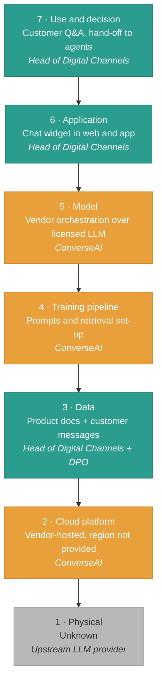

# System Fact Sheet: AI-003 Customer Chatbot "Sahm"

**Version:** 1.0 · **Date:** 2026-11-18 · **Prepared by:** AI Governance · **Next review:** 2027-05, or on any vendor model change

## 1. Identity

| Field | Value |
| --- | --- |
| Inventory ID | AI-003 |
| Vendor | ConverseAI (fictional) |
| Model version | **Not provided by vendor** |
| Business owner | Head of Digital Channels |
| Technical owner | ConverseAI |
| Value-chain role | Deployer (role-change risk if purpose changes, see §2) |
| Lifecycle status | Production |

## 2. Purpose

**Intended use:** answer retail customers' questions about MGB products, fees and processes on the website and app, in Arabic and English, and hand complex cases to a human agent.

**Out of scope (must not be used for):**
- Eligibility, credit or affordability advice
- Complaint outcomes or decisions on disputes
- Collecting card numbers, PINs or passwords
- Any use after fine-tuning on MGB customer data without a governance review

> Using the chatbot for eligibility or credit advice would change its intended purpose into a high-risk use and could make MGB the provider (EU AI Act Art. 25). Any such change must come through AI Governance first.

## 3. Model

| Field | Value |
| --- | --- |
| Output type | Generation (text) |
| Algorithm family | Neural network: large language model licensed by the vendor |
| Explainability | **Low:** answers cannot be traced to readable reasoning |
| Upstream model | **Unknown:** vendor licenses a third-party LLM and will not name it |
| How MGB content is used | Vendor retrieves answers from MGB's product knowledge base (vendor statement) |

## 4. Data

| Field | Value |
| --- | --- |
| Pre-training data | **Not provided by vendor** (upstream provider does not share) |
| MGB data used | Product documents (retrieval); live customer messages |
| Chat log retention | **Not provided by vendor** |
| Use of MGB data to train vendor models | **Not confirmed** |

## 5. Performance

| Measure | Result |
| --- | --- |
| Vendor test results | **Not provided by vendor** |
| MGB's own test | Planned: 200 questions in Arabic and English, including adversarial prompts (Week 4) |
| Hand-off rate to humans | Not yet measured |

## 6. Stack

MGB directly controls 3 of 7 layers. Evidence for the rest can only come through the contract and the vendor review (Week 13).

## 7. Oversight and challenge

- The chatbot tells customers they are talking to an AI assistant.
- Customers can ask for a human agent at any time.
- Questions about eligibility, complaints or disputes are routed to staff.

## 8. Limitations and open issues

| # | Issue | Owner | Status |
| --- | --- | --- | --- |
| 1 | Upstream LLM and its training data unknown | Head of Digital Channels | Written request sent; gap accepted with review date |
| 2 | No vendor test evidence; MGB test not yet run | Head of Digital Channels | Week 4 red-team |
| 3 | Data residency and chat-log retention not confirmed | DPO | Open |
| 4 | No contractual notice of model changes | Procurement | Add at renewal |
| 5 | Prompt injection through customer messages not assessed | CISO | Week 10 threat model |

_Meridian Gulf Bank is fictional. All data is synthetic._
