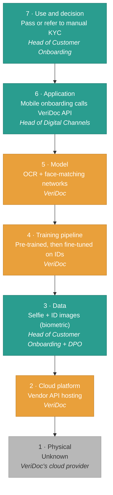

# System Fact Sheet: AI-008 KYC ID Document Verification

**Version:** 1.0 · **Date:** 2026-11-18 · **Prepared by:** AI Governance · **Next review:** 2027-05, or on any vendor model change

## 1. Identity

| Field | Value |
| --- | --- |
| Inventory ID | AI-008 |
| Vendor | VeriDoc (fictional) |
| Model version | **Not provided by vendor** |
| Business owner | Head of Customer Onboarding |
| Technical owner | VeriDoc |
| Value-chain role | Deployer |
| Lifecycle status | Production |

## 2. Purpose

**Intended use:** during digital onboarding, read the applicant's ID document (OCR), check it for signs of tampering, and compare the applicant's selfie with the ID photo. Pass, or refer to manual KYC review.

**Out of scope (must not be used for):**
- Identifying people from images outside onboarding (no one-to-many search)
- Inferring age, gender, ethnicity or emotion from faces
- Final rejection of an applicant without human review

## 3. Model

| Field | Value |
| --- | --- |
| Output type | Classification (match / no match, with a confidence score) |
| Algorithm family | Neural networks: OCR model and face-matching model |
| Explainability | **Low:** the network's features are learned, not chosen, and cannot be listed |
| Training | Pre-trained on public face images, fine-tuned on ID documents (vendor statement) |

## 4. Data

| Field | Value |
| --- | --- |
| Pre-training data | Public face images; **consent and composition not provided by vendor** |
| MGB data sent | Selfie and ID images per check (**biometric, special-category data**) |
| Retention at vendor | **Not provided by vendor**; MGB requires deletion after the check |
| Use of MGB images to retrain | **Not confirmed** |

## 5. Performance

| Measure | Result |
| --- | --- |
| Overall match accuracy | Vendor claims high accuracy; no test report provided |
| Accuracy by age, skin tone, document type | **Not provided by vendor** |
| MGB proxy measure | Manual-review referral rate by applicant segment (to start monthly) |

> Deep face-matching models can inherit weaknesses from their pre-training data and can be confidently wrong on unusual inputs. Low-confidence routing to a human helps, but it does not replace testing accuracy across the groups MGB serves.

## 6. Stack

## 7. Oversight and challenge

- Low-confidence and failed matches go to a trained KYC officer.
- Applicants who fail can complete onboarding in a branch or by video call.
- No applicant is rejected on the model's output alone.

## 8. Limitations and open issues

| # | Issue | Owner | Status |
| --- | --- | --- | --- |
| 1 | No accuracy breakdown by age, skin tone or document type | Head of Customer Onboarding | Requested from vendor; MGB referral-rate monitoring to start |
| 2 | Biometric data: explicit consent wording and deletion not verified | DPO | Open (Week 8 DPIA) |
| 3 | Pre-training data consent and composition unknown | Head of Customer Onboarding | Accepted gap with review date |
| 4 | Hosting location and sub-processors not provided | DPO + Procurement | Open |
| 5 | Explanation gap: recommends outcomes for applicants with low explainability | Head of AI Governance | Tracked in explainability matrix |

_Meridian Gulf Bank is fictional. All data is synthetic._
