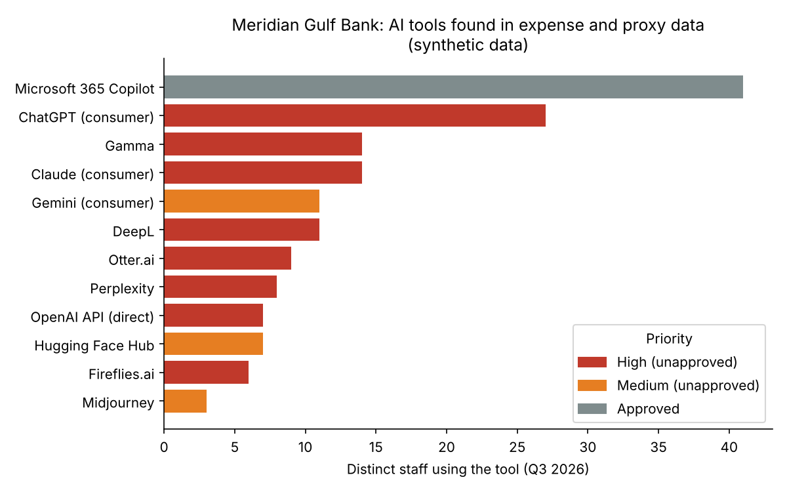

# Module 01: The AI Governance Job

**Problem:** Meridian Gulf Bank's AI register listed 9 systems, but nobody knew what AI staff actually used.

**What I built:**
- A shadow-AI scanner that matches expense and proxy data against an AI tool catalogue and flags unapproved tools
- A reconciliation script that feeds new findings into the bank's AI inventory without creating duplicates
- A completed 22-system AI inventory, a findings report for the CRO, and a value-chain role map with upstream-gap decisions

**Standards applied:** ISO/IEC 42001 clause 4 (context and scope), OECD and EU AI Act Art. 3(1) definition of an AI system, EU AI Act Art. 3, 25 and 53 (operator roles, role change, upstream documentation), Qatar PDPPL and GDPR (personal data in AI tools).

## Results

| Measure | Result |
| --- | --- |
| Known AI estate after discovery | **22 systems**, up from 9 |
| Unapproved | **13 (59%)** |
| Staff using unapproved AI | **45 of 120 (38%)** |
| Departments affected | All 8 |
| Most serious finding | MGB is building AI (direct model API, open-source client-screening model) with no oversight |

**Read:** [Findings report](findings-report.md) · [Role map](role-map.md) · [Analysis notes](analysis-notes.md) · [Inventory](../../00-inventory/inventory.csv)

## How it works

1. `scripts/generate_synthetic_data.py` creates one quarter of expense and proxy data for 120 staff (seeded, so it is reproducible).
2. `scripts/shadow_ai_scan.py` matches records against `data/ai_tool_catalogue.csv`, compares the hits with the approved register, prioritises each tool and writes `outputs/`.
3. `scripts/reconcile_inventory.py` adds unapproved tools to `00-inventory/inventory.csv`. It is safe to re-run.
4. The interview findings and owner assignments were added manually, as they would be in practice.

To run it locally: `pip install -r requirements.txt`, then run the three scripts in order.

## What I would do at work

- **Combine data with interviews.** Scans find paid web tools. Only conversations find embedded AI and team-built scripts, which carry the highest risk.
- **Lead with a sanctioned alternative, not a ban.** Banning pushes use onto personal phones where there is no visibility. Copilot demand (41 users in pilot) shows people will switch if given a good option.
- **Treat "who is building AI" as the first question.** Shifting from deployer to builder changes obligations more than any consumer chatbot does.

## Files

| Path | Purpose |
| --- | --- |
| `findings-report.md` | Discovery findings and recommendations for the CRO |
| `role-map.md` | Value-chain role for all 22 systems, upstream-gap decisions, scoping exclusions |
| `analysis-notes.md` | Working analysis of the scan results |
| `scripts/` | Scanner, reconciliation script, synthetic data generator |
| `data/` | Synthetic expenses, proxy logs, AI tool catalogue, register export |
| `outputs/` | Scan findings (CSV), summary and chart |

_Meridian Gulf Bank is fictional. All data is synthetic. This is independent study._
