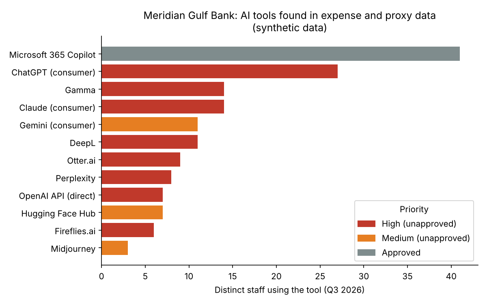

# Shadow-AI Discovery: Findings Report

**Organisation:** Meridian Gulf Bank (fictional) · **Scope:** expense claims and web-proxy logs for Q3 2026 (1 Jul – 30 Sep), plus three team-head interviews · **Prepared for:** Chief Risk Officer · **Prepared by:** Augustine Ozor, AI Governance · **Version:** 1.0 · **Date:** 2026-11-09 · **Classification:** Internal

## 1. Summary

MGB's approved AI register lists 9 systems. Discovery found 13 more that nobody approved: 11 from expense and proxy data and 2 from interviews. That brings the known AI estate to **22 systems, 59% of them unapproved**. In Q3, 45 of 120 staff in the sample (38%) used at least one unapproved AI tool.

The most serious finding is not consumer chatbot use. It is that **IT staff are building software on a model API with a personal key (AI-016), and a Compliance analyst is screening clients with an unreviewed open-source model (AI-022)**. Both make MGB a builder of AI systems with no oversight, no records and no owner.

## 2. Method

| Step | What was done |
| --- | --- |
| Data sources | Expense export (161 claims) and web-proxy logs (3,630 records) for Q3 2026, plus the approved AI register export |
| Detection | Pattern matching against a catalogue of 18 merchant and domain patterns covering 12 known AI tools (`data/ai_tool_catalogue.csv`) |
| Comparison | Each detected tool checked against the approved register |
| Interviews | Heads of Finance, Compliance and Operations, asked: "Which tools or features in your area produce predictions, content or recommendations?" |
| Prioritisation | **High:** model API or meeting note-taker, or used in HR, Compliance, SME Lending or Finance. **Medium:** other unapproved tools. **Low:** approved tools |
| Tooling | `scripts/shadow_ai_scan.py` and `scripts/reconcile_inventory.py` (reproducible, synthetic data) |

## 3. Findings

### 3.1 Headline numbers

| Measure | Result |
| --- | --- |
| AI tools detected in expense and proxy data | 12 (11 unapproved, 1 approved: Microsoft 365 Copilot) |
| Additional AI found through interviews | 2 (both unapproved) |
| Known AI estate after discovery | 22 systems (9 approved, 13 unapproved) |
| Staff using at least one unapproved tool | 45 of 120 (38%) |
| Unapproved AI spend via expense claims | QAR 3,149 for the quarter |
| Departments with unapproved AI use | All 8 |

### 3.2 All unapproved tools

| Priority | ID | Tool | Users | Departments | Discovered via |
| --- | --- | --- | --- | --- | --- |
| High | AI-010 | ChatGPT (consumer) | 27 | Finance, HR, Marketing, Retail, SME Lending | expense + proxy |
| High | AI-011 | Claude (consumer) | 14 | Compliance, IT | proxy |
| High | AI-012 | Gamma | 14 | Marketing, SME Lending | expense + proxy |
| High | AI-013 | DeepL | 11 | Compliance, Operations | expense + proxy |
| High | AI-014 | Otter.ai | 9 | HR, Operations | expense + proxy |
| High | AI-015 | Perplexity | 8 | Compliance, Finance | expense + proxy |
| High | AI-016 | OpenAI API (direct) | 7 | IT | expense + proxy |
| High | AI-017 | Fireflies.ai | 6 | Compliance, Retail | expense |
| High | AI-022 | Adverse-media sentiment script | 1 | Compliance | interview |
| Medium | AI-018 | Gemini (consumer) | 11 | Operations, Retail | proxy |
| Medium | AI-019 | Hugging Face Hub | 7 | IT | proxy |
| Medium | AI-020 | Midjourney | 3 | Marketing | expense |
| Medium | AI-021 | FP&A AI forecasting | n/a | Finance | interview |

AI-022 is rated High because it screens clients and therefore affects them directly. AI-021 is rated Medium because it informs internal forecasts and uses no personal data.

### 3.3 Top three findings in detail

**Finding 1: MGB is building AI without knowing it (AI-016, AI-019, AI-022).** Seven IT staff call a model API directly, charged to one person's card, and seven download open-source models. Separately, a Compliance analyst runs a script that uses an open-source sentiment model to flag clients in adverse-media screening. This moves MGB from deployer to **builder** for these systems, with no design review, no testing and no record of what data goes in. AI-022 matters most: an unvalidated model is influencing financial-crime decisions about named clients, and the model has never been tested on financial news.

**Finding 2: Meeting note-takers are recording HR and Compliance conversations (AI-014, AI-017).** Otter.ai is used in HR and Operations, and Fireflies.ai in Compliance and Retail. Interviews with candidates and staff, and possibly client calls, are likely being recorded and stored with vendors MGB has no contract with. These recordings can include special-category data, such as health information disclosed in HR conversations, and nobody has given informed consent. This is a data protection exposure under Qatar's PDPPL (Law No. 13 of 2016) and, for the Dublin branch, the GDPR.

**Finding 3: Consumer chatbots are the default work tool in credit and HR (AI-010).** ChatGPT is the most widely used unapproved tool (27 staff), including in SME Lending and HR. SME credit analysts are the likeliest group to paste client financial statements into it. Under consumer terms, MGB has no contract, no assurance about data retention or training use, and no audit trail. The approved alternative, Microsoft 365 Copilot (AI-005), is still in pilot, and its 41 users show the demand is real.

## 4. Limitations: what this evidence cannot establish

1. **Content.** Proxy logs show traffic volume, not what was sent. The report cannot confirm that customer data was entered into any tool, only that the conditions for it exist.
2. **Personal devices and mobile data.** Use on phones and home networks outside the proxy is invisible, so the true usage figure is likely higher than 45.
3. **Free tiers.** Expense data only catches paid subscriptions. Free use appears only where it passes through the proxy.
4. **Catalogue coverage.** The scan only finds the 12 tools in the catalogue. Any AI tool not listed would not appear.
5. **Embedded AI.** AI features inside approved software, such as AI-021, cannot be seen in either data source. They were found only through interviews, and only 3 of 8 department heads were interviewed.
6. **Synthetic data.** This exercise uses synthetic data, so the patterns illustrate the method and are not a measurement of a real organisation.

## 5. Recommendations

| # | Action | Addresses | Owner (role) | Due |
| --- | --- | --- | --- | --- |
| 1 | Stop AI-022 from influencing client decisions until it is validated. Analysts revert to manual review in the meantime | Finding 1 | Chief Compliance Officer | 2026-11-16 |
| 2 | Issue an interim AI acceptable-use notice: no customer, employee or confidential data in unapproved AI tools, and no AI note-takers in HR, Compliance or customer meetings | Findings 2, 3 | Chief Risk Officer, with the CISO | 2026-11-23 |
| 3 | Move API and open-source model use onto a sanctioned, company-paid platform with logging, and register each script as an inventory entry | Finding 1 | Chief Information Officer | 2026-12-31 |
| 4 | Accelerate the Copilot rollout to SME Lending and HR as the sanctioned alternative to consumer chatbots | Finding 3 | Chief Operating Officer | 2027-01-31 |
| 5 | Launch an AI intake form, and complete interviews with the remaining 5 department heads | All, plus Limitation 5 | Head of AI Governance | 2026-12-15 |

## 6. Inventory impact

- `00-inventory/inventory.csv` grew from 9 to **22 systems**. Every entry has a role owner, an approval status and a recorded discovery source.
- 13 entries are marked `unapproved` and are waiting for a decision: approve, replace or retire.
- 19 entries have an `upstream_evidence_gap`. See `role-map.md` for the response chosen for each.
- One candidate, the Operations Excel macro, was reviewed and excluded as not AI. The reasoning is in `role-map.md`.

---
_Meridian Gulf Bank is fictional. All data is synthetic. This is independent study._
