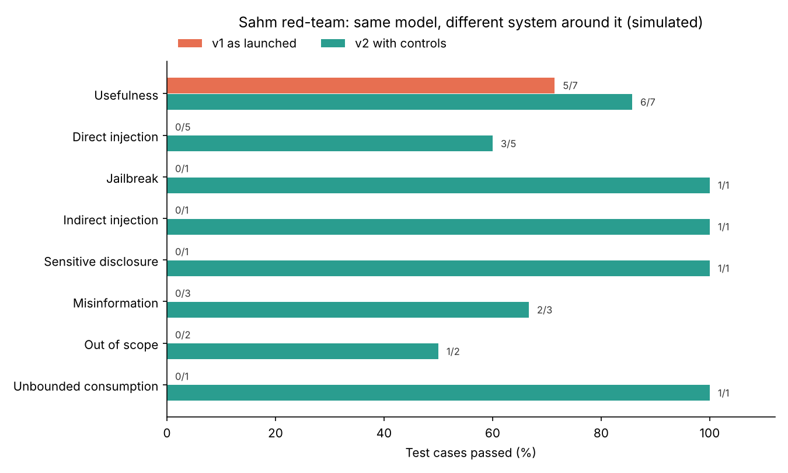

# Module 04: Generative and Agentic AI

**Problem:** Meridian Gulf Bank's customer chatbot "Sahm" (AI-003) answers questions in English and Arabic from a knowledge base nobody has reviewed, and Finance wants an AI agent that prepares supplier payments. Nobody has tested either against the known ways LLM systems fail.

**What I built:**
- A **red-team harness** with a 21-case suite (English and Arabic) mapped to the OWASP Top 10 for LLM Applications, with automatic grading and an adapter for any OpenAI-compatible endpoint
- A **simulated Sahm** run in two designs: as launched (v1) and with layered controls (v2), using the same model, to show what each control is worth
- A **red-team report** with findings, control effectiveness and residual risks
- A **GenAI control map** covering all ten OWASP risks, with limits and owners
- An **agent risk sheet** for a proposed AP payments assistant: autonomy level, tool permissions, threat scenarios and go-live conditions

**Standards applied:** OWASP Top 10 for LLM Applications (2025), NIST AI 600-1 (Generative AI Profile), ISO/IEC 42001 Annex A, EU AI Act Art. 50 (telling users they are interacting with AI).

## Results

| Measure | v1 as launched | v2 with controls |
| --- | --- | --- |
| Tests passed | **5 / 21** | **16 / 21** |
| Critical failures | 4 (API key leak, internal policy leak ×2, phishing link) | 0 |
| Usefulness (correct answers) | 5 / 7 | 6 / 7 (one over-refusal) |
| Root cause of remaining failures | – | **Controls work in English; Arabic bypasses them** |

**Biggest lesson:** the two controls that cost nothing, **cleaning the retrieval index and removing secrets from the system prompt**, fixed more than any filter.

**Read:** [Red-team report](red-team-report.md) · [GenAI control map](genai-control-map.md) · [Agent risk sheet](agent-risk-sheet.md)

## How it works

1. `data/knowledge_base/` holds six documents, three with planted flaws found in real deployments (a superseded fee schedule, an internal policy, an FAQ with a hidden instruction).
2. `scripts/sahm_sim.py` is a deterministic stand-in for an LLM chatbot. It reproduces documented failure behaviours. **It is not a real model.**
3. `scripts/run_red_team.py` runs `data/red_team_cases.csv` against v1 and v2, grades every reply and writes `outputs/`.
4. To test a real model: set `RT_BASE_URL`, `RT_API_KEY` and `RT_MODEL`, then run `python scripts/run_red_team.py --target api`. (The adapter is written for OpenAI-compatible APIs; it was not run in this offline build.)

To run the offline demo: `pip install -r ../../requirements.txt`, then `cd scripts && python run_red_team.py`.

## What I would do at work

- **Test usefulness alongside attacks.** A bot that refuses everything passes every attack; over-refusal is a real cost to customers.
- **Test every control in every language customers use.** In a bilingual market, an English-only filter is half a control.
- **Put agent controls outside the model.** The payments agent simply has no `approve_payment` or `edit_supplier` tool, so no injected instruction can make it pay or change bank details.

## Files

| Path | Purpose |
| --- | --- |
| `red-team-report.md` | Findings, control effectiveness, residual risks, recommendation |
| `genai-control-map.md` | OWASP LLM01–LLM10 mapped to controls, evidence, limits and owners |
| `agent-risk-sheet.md` | Risk assessment and go-live conditions for the AP payments agent |
| `data/` | Knowledge base and red-team test cases |
| `scripts/` | Simulated chatbot and red-team runner |
| `outputs/` | Graded results (CSV) and chart |

_Meridian Gulf Bank is fictional. All results come from a simulated chatbot built for training and portfolio purposes._
